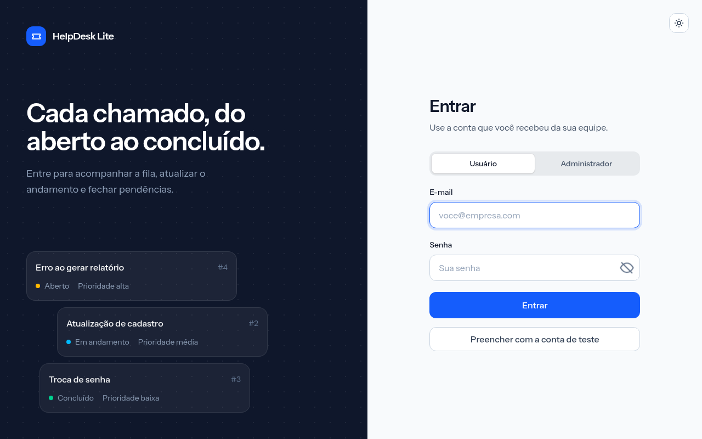
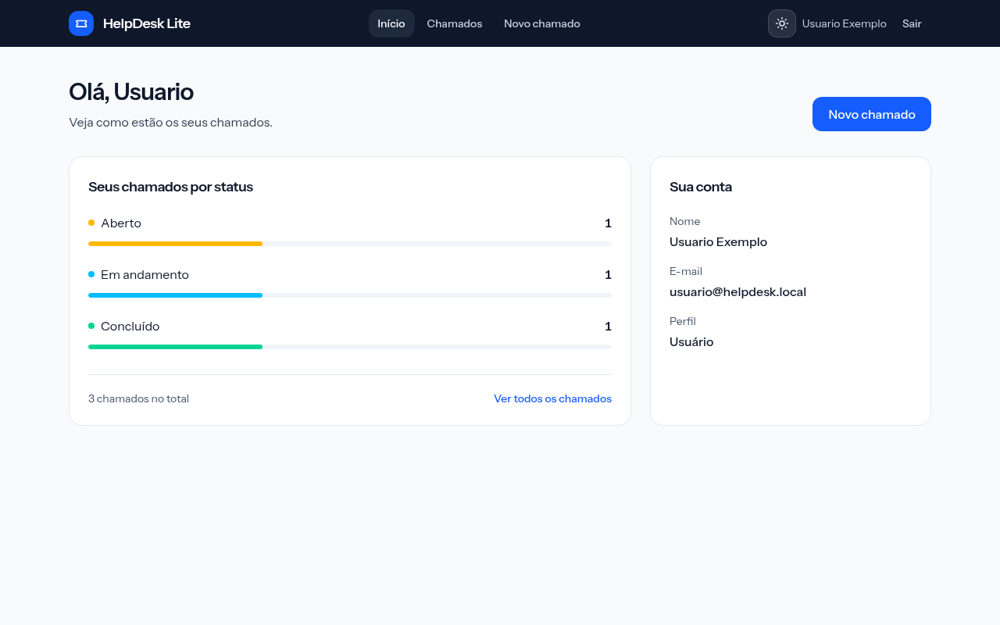
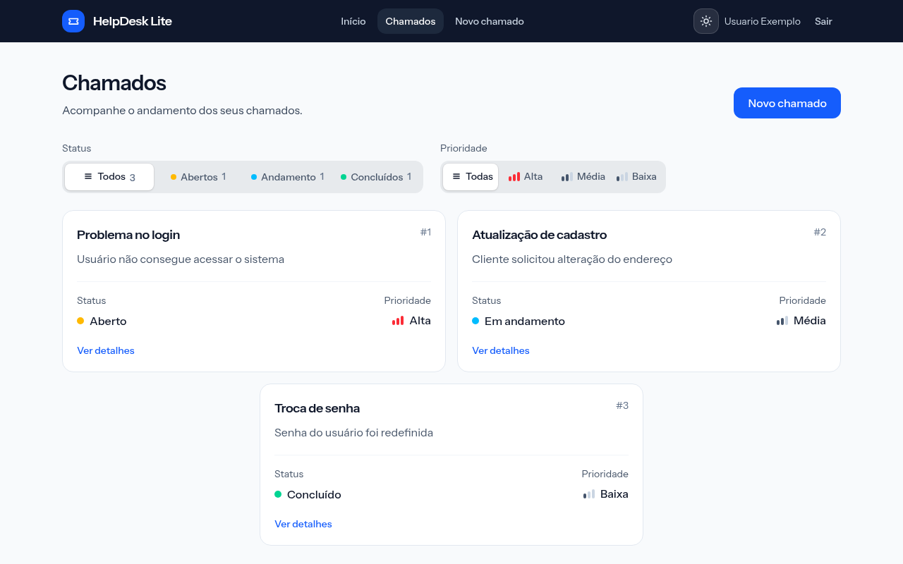
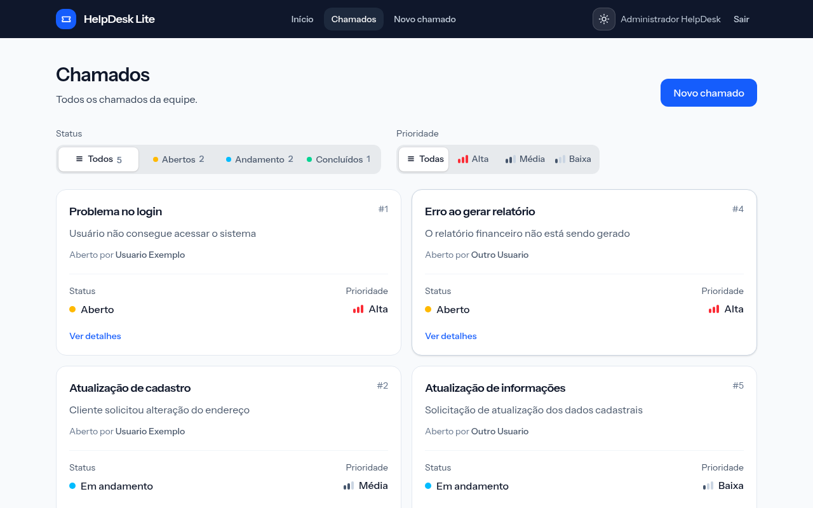
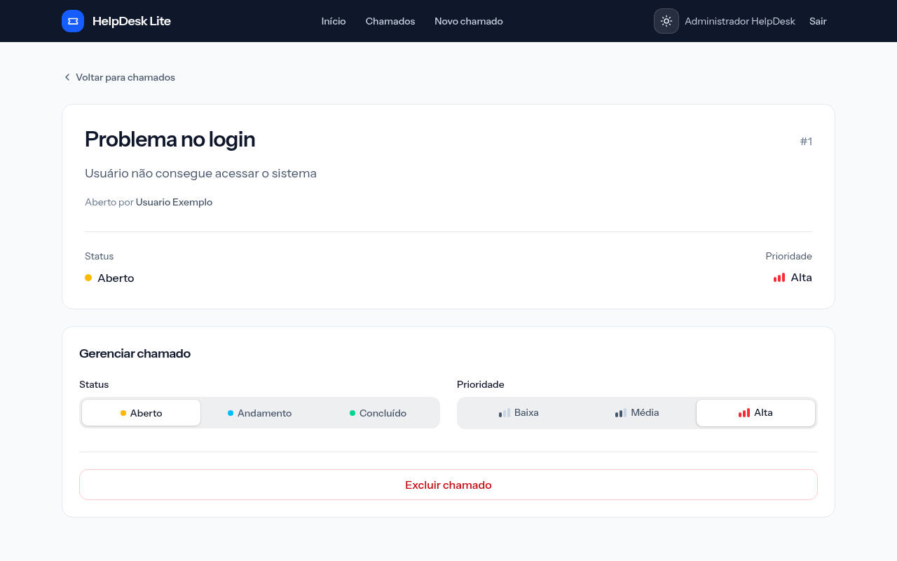
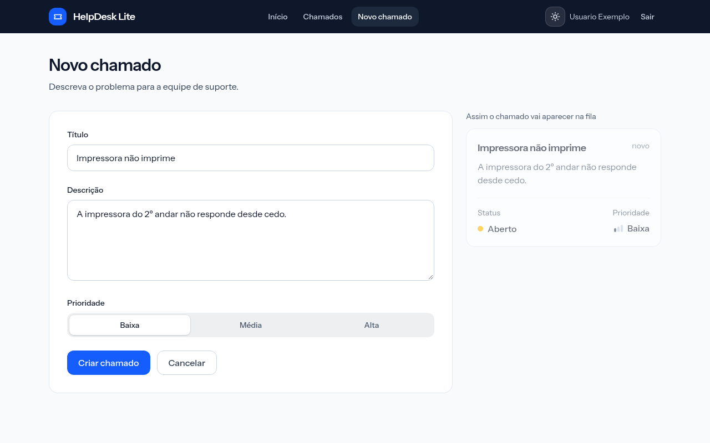
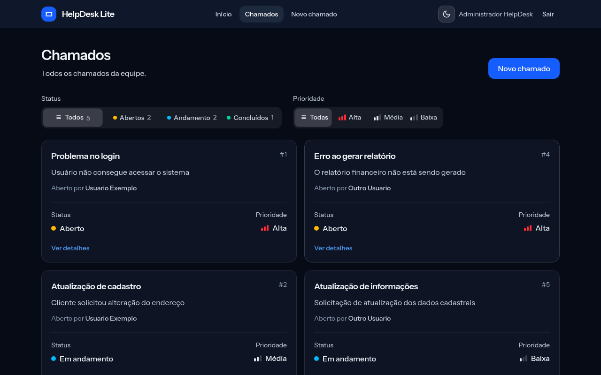

# HelpDesk Lite

Sistema de chamados com login por JWT e dois perfis (usuário e administrador). Front em React + TypeScript e API em Node.js (Express).

| Pasta | O que é |
|---|---|
| [`front/`](front) | Interface em React, TypeScript, Vite e Tailwind |
| [`api/`](api) | API REST em Node.js + Express (regras de negócio, JWT, banco em arquivo JSON). Documentação em [`api/README.md`](api/README.md) |

## O que tem

- **Login** com os dois perfis, olho da senha que acompanha o mouse e botão que preenche a conta de teste.
- **Cada chamado é de uma pessoa:** o usuário vê e gerencia só os seus; o administrador vê todos, com o nome de quem abriu.
- **Chamados:** lista com filtros de status e prioridade, detalhe, criação, edição e exclusão com confirmação. Só o administrador muda o status.
- **Modo claro e escuro**, com a troca animada a partir do botão.
- **Bloqueio de login:** 5 senhas erradas seguidas bloqueiam o e-mail por 5 minutos.

## Telas

| | |
|---|---|
|  **Login** |  **Início (usuário)** |
|  **Chamados: o usuário vê só os seus** |  **Chamados: o admin vê todos, com o dono** |
|  **Detalhe e gerenciamento (admin)** |  **Novo chamado, com prévia** |



## Como rodar

Precisa de Node 20+.

**1. API** (porta 5050)

```bash
cd api
cp .env.example .env     # troque o JWT_SECRET por uma chave sua
npm install
npm start
```

O banco (`api/data/database.json`) é criado na primeira execução, com os dados de exemplo.

**2. Front**

```bash
cd front
cp .env.example .env     # URL da API (VITE_API_URL)
npm install
npm run dev
```

Abra `http://localhost:5173`.

## Contas de teste

Fictícias, só para demonstração. A tela de login tem o botão **Preencher com a conta de teste**.

| Perfil | E-mail | Senha |
|---|---|---|
| Administrador | `admin@helpdesk.local` | `Admin@123` |
| Usuário | `usuario@helpdesk.local` | `Usuario@123` |
| Usuário | `outro@helpdesk.local` | `Outro@123` |

No login, escolha "Administrador" para entrar com a conta de admin.

## Docker

O `Dockerfile` da raiz gera uma imagem única: compila o front e a API serve o site e os endpoints na mesma porta (3000), sem CORS. Defina `JWT_SECRET` e monte um volume em `/data` para guardar o banco.

```bash
docker build -t helpdesk .
docker run -p 3000:3000 -e JWT_SECRET=troque-isto -v helpdesk-data:/data helpdesk
```

## Testes da API

```bash
cd api
npm test
```
